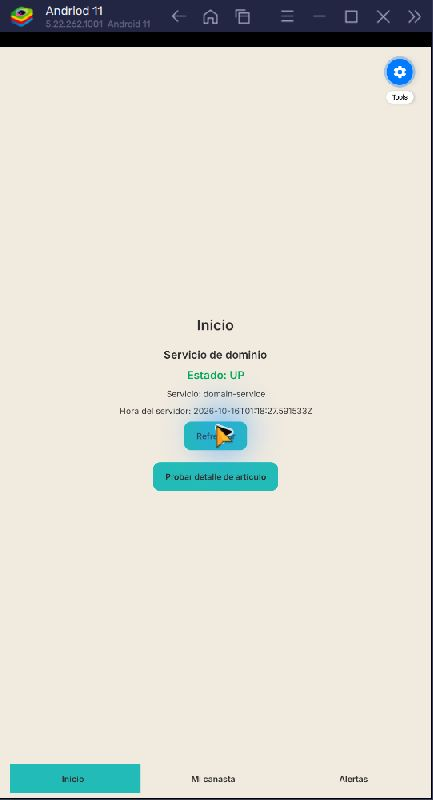
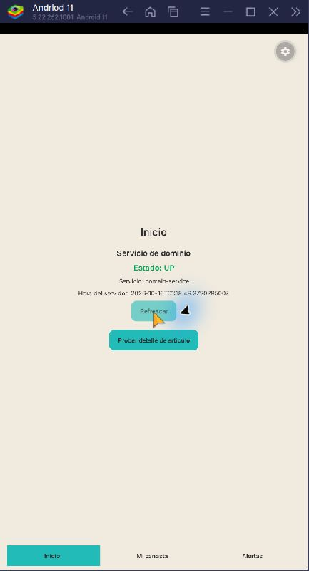
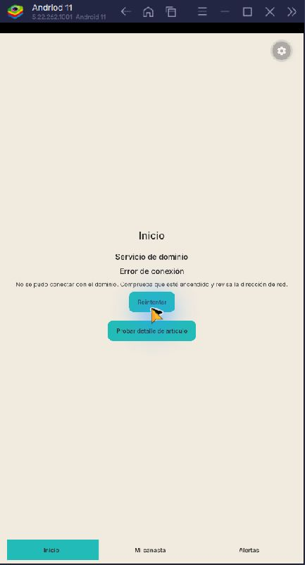

# Evidencia de T039

Prueba realizada el 15 de octubre de 2026 en BlueStacks, instancia Android 11,
con Expo Go para SDK 55 y el servicio real de dominio ejecutándose con JDK 21.
Esta evidencia corresponde a T039 (#120). La corrección completa de las cuatro
pestañas de D-01 sigue pendiente en una solicitud separada.

## Respuesta del dominio

Inicio muestra `UP`, `domain-service` y la hora que devuelve `GET /health`.

## Refresco

Al pulsar Refrescar se realizó otra consulta y cambió la hora del servidor.

## Dominio apagado

Se detuvo el proceso del dominio y se pulsó Refrescar. La app mostró el error
de conexión y el botón Reintentar, sin permanecer cargando indefinidamente.
La función tiene un tiempo límite de 8 segundos; un fallo de conexión puede
detectarse antes. El tiempo límite se verificó también en una prueba del cliente
con una petición que no responde.

## Recuperación

Se inició nuevamente el dominio y se pulsó Reintentar. La app volvió a mostrar
`UP` y una nueva hora, sin reiniciar Expo Go.

Las capturas son de la app Android; no son una prueba en Expo web ni respuestas
de un servidor simulado.
