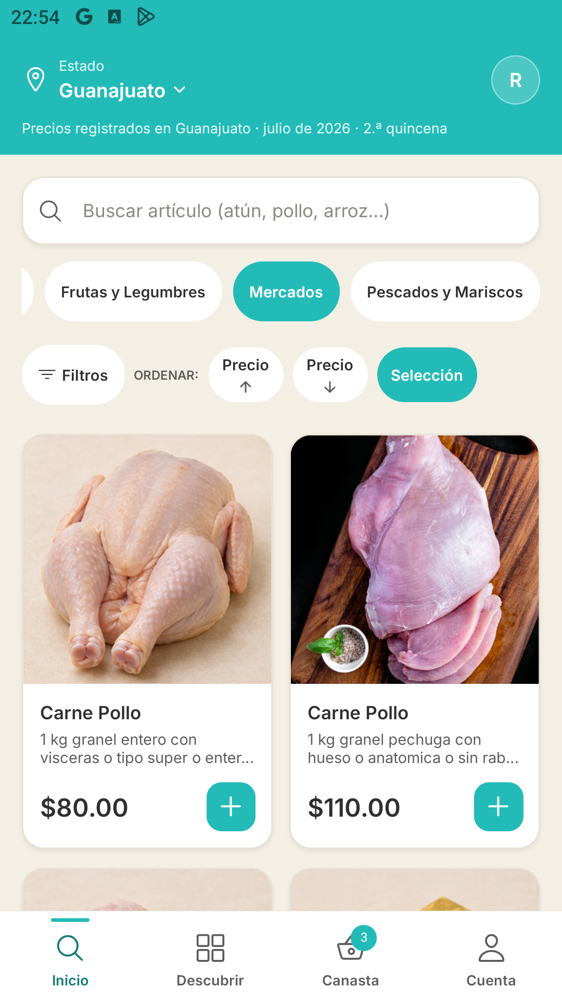
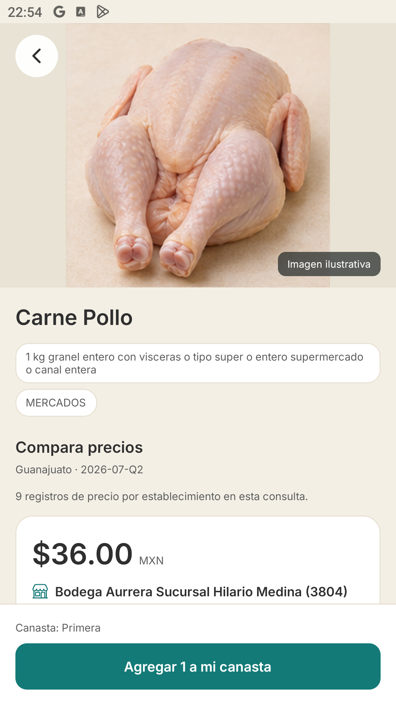

# Manual de usuario de CanastaMX

CanastaMX permite consultar y comparar precios registrados en los datos abiertos
de PROFECO y organizar artículos en canastas. Es un proyecto académico independiente;
no es una aplicación oficial de PROFECO.

## Instalar y abrir

1. Recibir el APK final v10 por el canal de entrega del equipo y abrirlo en Android.
2. Si Android lo solicita, permitir la instalación desde la aplicación utilizada
   para abrir el archivo. Al terminar se puede desactivar ese permiso.
3. Abrir CanastaMX con internet disponible y elegir **Explorar artículos** o
   **Iniciar sesión**. Para actualizar una instalación compatible, instalar encima;
   no es necesario desinstalar ni borrar datos.

La app se conecta a los servicios públicos de
[Dominio](https://dominio.canastamx.duckdns.org) y
[Analítica](https://analitica.canastamx.duckdns.org). La computadora del usuario
puede permanecer apagada. La disponibilidad depende de esos servidores y de la red.

## Explorar y seleccionar estado

Tocar el nombre del estado en el encabezado y seleccionar directamente una entidad
de la lista. No hay que escribirla. Si no existe cobertura, Inicio lo informa y
muestra las entidades disponibles; se puede seleccionar otra.

En Inicio, escribir al menos dos caracteres, por ejemplo **leche**. Elegir el
catálogo que corresponda. La búsqueda considera el producto y su presentación:
una palabra como aceite puede aparecer también en la descripción de un shampoo.

Los filtros permiten indicar un precio desde y hasta; el mínimo no debe superar
el máximo. Los botones de precio ascendente y descendente ordenan los resultados
cargados. Usar la opción de cargar más cuando aparezca para consultar otros
resultados. Cambiar la entidad o la búsqueda puede iniciar una nueva consulta.

## Consultar un artículo y comparar

Tocar la imagen o el nombre del artículo para abrir el detalle. Revisar presentación,
entidad, quincena y registros por establecimiento, con los datos disponibles de
marca, dirección y fecha. El precio típico es una referencia estadística de QQP;
no garantiza el precio actual al pagar.

Las imágenes son ilustrativas del tipo de producto; no identifican necesariamente
su marca o envase. Si no existe una correspondencia adecuada, aparece **Sin
fotografía asignada**. Las observaciones son registros de precio, no reseñas.

## Crear una cuenta e iniciar sesión

1. Desde la portada o Cuenta, elegir crear una cuenta.
2. Introducir correo, contraseña y confirmación. La contraseña debe tener entre
   8 y 72 caracteres, al menos una mayúscula y un número.
3. Confirmar el registro y después iniciar sesión con esas credenciales. Si el
   correo ya está registrado, usar la opción de iniciar sesión.

Se puede buscar y comparar como invitado. Para guardar y administrar canastas
hay que iniciar sesión. En Cuenta se muestra el correo de la sesión y la opción
**Cerrar sesión**. Cerrar la sesión no elimina las canastas guardadas en la cuenta.

## Administrar canastas

1. En Canasta, abrir el selector mediante el nombre de la canasta o su control
   de configuración. Elegir una existente o **Crear nueva canasta** e indicar nombre.
2. Desde Inicio, tocar **+** en un artículo y elegir la canasta de destino. En el
   detalle también se puede seleccionar canasta y cantidad antes de agregar.
3. Volver a Canasta para revisar sus artículos. Usar **−**, **+** o editar la
   cantidad; confirmar la eliminación cuando se solicite.
4. En **Mis canastas**, seleccionar la activa o editarla para renombrar o eliminar.
   Revisar la confirmación antes de eliminar una canasta.

El cálculo usa la entidad seleccionada y muestra costos por cadena. Cada total
corresponde a su cadena: no se deben sumar como si fueran una sola compra. Si
faltan precios, el resultado puede ser parcial; un precio ausente no equivale a cero.
Sin cobertura, se indica que no hay precios disponibles.

Si se pierde la respuesta al guardar, actualizar las canastas antes de repetir la
operación para comprobar si ya se aplicó. La app pide recuperar el estado cuando
una escritura queda incierta.

## Cuenta y Descubrir

Cuenta reúne el acceso, las canastas, información del proyecto y un apartado
desplegable de estado de conexión. Descubrir conserva su pestaña con un aviso de
que no está disponible y un botón para volver a explorar. Alertas, favoritos y
recuperación de contraseña no forman parte de esta entrega.

## Resolver problemas frecuentes

| Situación | Qué hacer |
|---|---|
| No hay cobertura en la entidad | Seleccionar una de las entidades indicadas por la app. No se soluciona repitiendo la misma consulta. |
| La búsqueda tarda | Mantener la consulta abierta; el límite de espera de búsqueda es de cinco minutos. Si falla, reintentar. Este límite no garantiza que el servidor responda. |
| No hay conexión o el servicio está en mantenimiento | Comprobar internet, revisar Estado de conexión en Cuenta y volver a intentar cuando el servicio se recupere. |
| No aparecen coincidencias | Revisar término, catálogo y filtros; probar un nombre más general. |
| No se pueden guardar canastas | Comprobar que la sesión esté iniciada y que Dominio responda. Actualizar antes de repetir una operación incierta. |
| No hay precio para un artículo | Revisar entidad y cobertura. Conservar el artículo no genera un precio ficticio. |

La fecha y quincena visibles pertenecen a los registros disponibles, no
necesariamente al día de la consulta.
